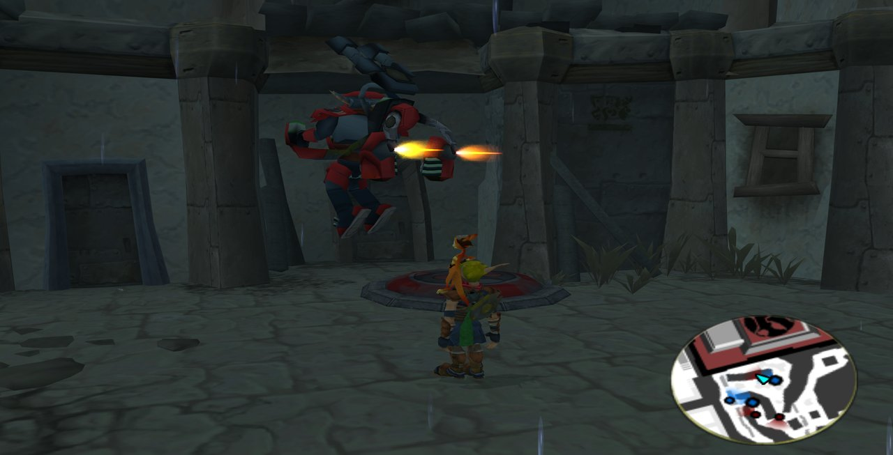
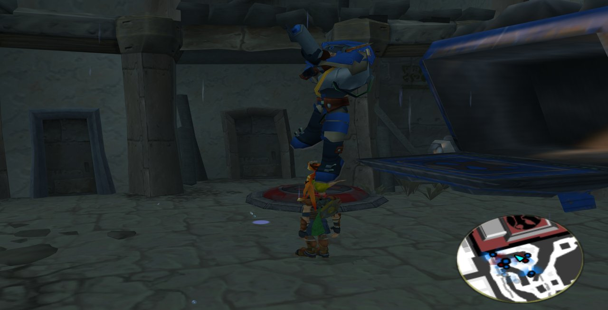
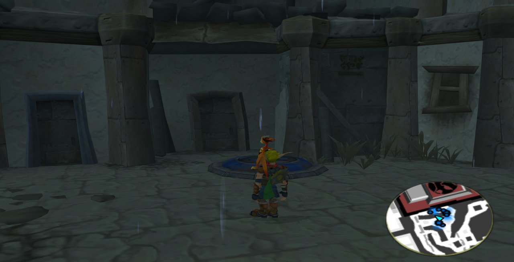
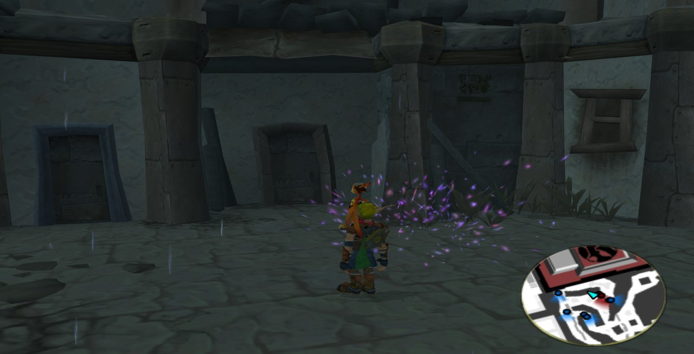
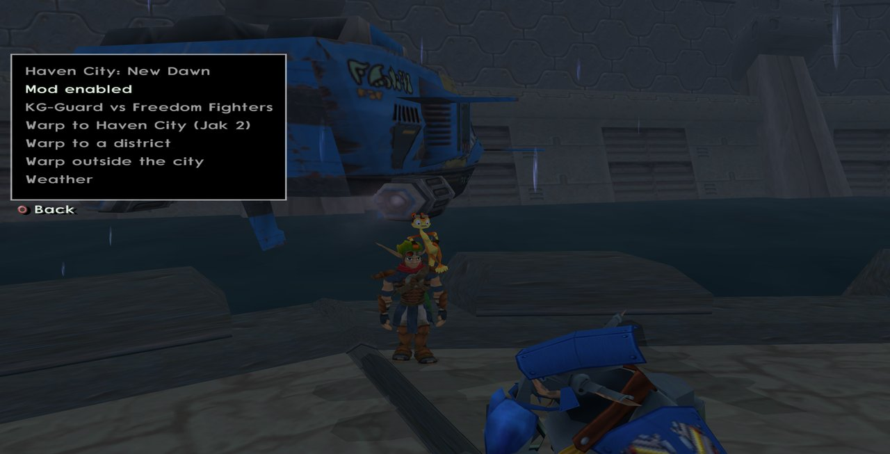

# Haven City: New Dawn — Jak 3

<p align="center">
  
  
  
</p>

> **Contents:** [Overview](#overview) · [Requirements](#requirements) · [Key Features](#key-features) · [Controls](#controls) · [Download & Play](#download--play-via-opengoal-launcher-players) · [Developer Setup](#developer-setup--local-compilation) · [Demo Video](#demonstration-video) · [Technical Documentation](#technical-documentation)

---

## Overview
Jak 2's Haven City and the places around it, playable inside Jak 3, as they are at the end of
Jak 2: the city district by district, its interiors, the palace, Dead Town, the pumping station,
the mountain, Haven Forest, the fortress and its prison, the stadium and the dig site. Everything
is rebuilt from your own copy of Jak 2. A war mode sets Jak 2's Krimzon Guards against Jak 3's
Freedom League.

- **Target Game:** Jak 3
- **Repository:** [`whozghiar/jak3-mod-haven-city-new-dawn`](https://github.com/whozghiar/jak3-mod-haven-city-new-dawn)



## Requirements

> [!IMPORTANT]
> You need your own copy of **both Jak 2 and Jak 3** (discs, or ISOs made from them). Made and
> tested with the European Jak 2 (PAL, SCES-51608) and the American Jak 3 (NTSC-U, SCUS-97330).
> The mod contains nothing of either game: its levels, models, textures, music and voices are
> made on your machine from your games.

## Key Features
- **Jak 2's city:** its 14 districts and the stadium grounds, loaded district by district like in
  Jak 2, with their lighting, water, particles, neon signs, breakable speakers and market props.
- **The places around it:** 30 more levels (the Hip Hog, the hideout, the Oracle, Vin's power
  station, Keira's garage, the palace pillar and roof, Dead Town and the Sage's hut, the
  construction site, the pumping station, the mountain and its canyon, Haven Forest, the fortress,
  its prison and the way out, the stadium's race track, the castle pad, the dig, Onin's tent),
  reached through Jak 2's own doors, elevators and air trains.
- **The end of Jak 2:** each level as it is once the game is finished, with its hazards (fans,
  turrets, lasers, the avalanche, the gun buoy), its platforms and decor, and no enemies.
- **Life in the city:** Jak 3's citizens, guards, hover bikes and cars at Jak 2's density; Jak 2's
  Hellcats and Krimzon bikes, which Jak can steal; Jak 2's five alert levels, with guards hunting
  Jak, guard vehicles chasing him and the anti-air turrets firing at him in a vehicle; Jak 2's
  city maps on the minimap.
- **War mode, KG-Guard vs Freedom Fighters:** red and yellow Krimzon Guards fight the Freedom
  League's blue guards in Jak 2's city and in Jak 3's own, to Jak 3's fight music. Troop
  transports of both sides drop guards, jetpack guards fly in, Hellcats and bikes fly in both
  sides' colors, the citizens flee and the Krimzon Guards hunt them. A fallen guard dissolves in
  a purple cloud. Krimzon Guards also stand in the places around the city.
- **Jak 2's sound:** each place's music and ambience, the citizens' and guards' lines, the Baron's
  speeches from the propaganda speakers (Torn's, recorded for the mod, when the game is in French
  and the war is off).
- **Mini-games:** the Hip Hog's Whack-a-Metal-Head, Onin's bubble game, Vin's game from Jak 3.
- **Time and weather:** a fixed hour or Jak 2's day and night; Jak 3's weather or a fixed one.
- **Travelling and saves:** warps to every district and place from the menu, two time gates
  between Jak 3's Freedom HQ and Jak 2's hideout, respawn at Jak 2's closest point, saving
  anywhere.

| | |
|---|---|
|  |  |
|  |  |

## Controls

| Action | How |
|---|---|
| Open the mod's menu | L3 + SELECT, then Mods ▸ Haven City: New Dawn |
| Take an air train or a time gate, play a mini-game | Triangle when the prompt shows; R3 quits a game |

| Menu entry | Does |
|---|---|
| Mod enabled | Switches the mod on or off (off at each boot); off, Jak 3 is unchanged |
| KG-Guard vs Freedom Fighters | Switches the war mode on or off (off at each boot); greyed out while the mod is off |
| Warp to Haven City (Jak 2) | Warps to the underground hideout |
| Warp to a district | Warps to each district or to a place in it |
| Warp outside the city | Warps to the places outside the city, or back to Jak 3's Freedom HQ |
| Weather | The weather in the whole game, and the hour in Jak 2's levels |

## Download & Play via OpenGOAL Launcher (Players)

> [!WARNING]
> Not published yet: the repository is private and has no release. Until then, build it from
> source ([Developer Setup](#developer-setup--local-compilation)).

Install Jak 2 and Jak 3 in the OpenGOAL Launcher first, each from your own ISO. While the launcher
installs the mod, it makes the mod's levels from your installed Jak 2 (a minute or two more than
a usual mod); without Jak 2 the install stops with error code 4060.

### Option A — Add Custom Mod Source (Recommended)
1. In the **OpenGOAL Launcher**, open **Settings ▸ Mods ▸ Add Custom Mod Source**.
2. Paste this catalog URL:
   ```text
   https://raw.githubusercontent.com/whozghiar/jak3-mod-haven-city-new-dawn/main/index.json
   ```
3. In the **Mods** tab, find **Haven City: New Dawn** and click **Install**.

### Option B — Manual Installation from GitHub Releases
1. Download the package for your system from the [Releases](https://github.com/whozghiar/jak3-mod-haven-city-new-dawn/releases) tab (`windows-v*.zip` or `linux-v*.zip`).
2. Extract it into `<launcher installation folder>/features/jak3/mods/_local/haven-city-new-dawn/`.
3. Run the mod's decompile and compile from the launcher, then launch the game.

---

## Developer Setup & Local Compilation

1. Copy each disc's files into `iso_data/jak2` and `iso_data/jak3`.
2. Build the tools and generate the levels (the first run extracts all of Jak 2, about 11 GB):
   ```bash
   task set-game-jak3
   task build-release-game
   task build-release-decomp
   task level-port -- custom_assets/jak3/ports/jak2-haven-city/port.jsonc
   ```
3. Build and run: `task repl`, then `(mi)`, then `task boot-game`. In the game, open the Mods menu
   and warp to Haven City.

## Demonstration Video

[](https://youtu.be/1_B4fGxRQZ0)

**[Watch the demonstration video on YouTube](https://youtu.be/1_B4fGxRQZ0)**

## Technical Documentation
- [`docs/modding/current_mod/haven_city_new_dawn_readme.md`](docs/modding/current_mod/haven_city_new_dawn_readme.md): how the mod works, for a developer new to GOAL, and the change log.
- [`docs/modding/current_mod/haven_city_new_dawn_reference.md`](docs/modding/current_mod/haven_city_new_dawn_reference.md): the detailed reference, feature by feature.

---
*(AI-assisted)*
