# Haven City: New Dawn — Developer guide

This guide explains how Haven City: New Dawn works, for a developer who has never written GOAL
Lisp: the ideas the mod relies on, why each change was made, and how to make the common changes
yourself (a color variant, a new hook). How each other feature works (the city, its loading, the
places, the traffic, the sound, the tools) is in
[`haven_city_new_dawn_reference.md`](haven_city_new_dawn_reference.md). Players only need the root
[`README.md`](../../../README.md).

**Contents**

1. [The mod in one page](#1-the-mod-in-one-page)
2. [GOAL for this mod](#2-goal-for-this-mod)
3. [Changing Jak 3 without breaking it: hooks](#3-changing-jak-3-without-breaking-it-hooks)
4. [From Jak 2's disc to Jak 3 levels: the level port](#4-from-jak-2s-disc-to-jak-3-levels-the-level-port)
5. [The war mode, step by step](#5-the-war-mode-step-by-step)
6. [Color variants](#6-color-variants)
7. [What the repository holds, and what it doesn't](#7-what-the-repository-holds-and-what-it-doesnt)
8. [Building and testing](#8-building-and-testing)
9. [Known issues](#9-known-issues)

## 1. The mod in one page

The mod puts Jak 2's Haven City and the places around it inside Jak 3, as they are at the end of
Jak 2, and adds two war modes: in Jak 2's world, Jak 2's Krimzon Guards fight Jak 3's Freedom
League; in Jak 3's city, once its story is over, Praxis's Krimzon Guard invades the conflict zones
chosen in the menu. Three kinds of work make it:

| Kind | Where | Made by |
|---|---|---|
| Level data: geometry, actors, doors, navigation, models, sounds | `custom_assets/jak3/levels/`, `custom_assets/jak3/models/custom_levels/` | Generated from your Jak 2 disc by the level port ([4](#4-from-jak-2s-disc-to-jak-3-levels-the-level-port)), never committed |
| The mod's GOAL code | `goal_src/jak3/pc/features/jak2-haven-city-*.gc`, `goal_src/jak3/levels/havenj2/`, `goal_src/jak3/levels/city/war/` | Written by hand |
| A few lines in Jak 3's own code | Lines marked `og:jak2-haven-city added` | Written by hand, each calling the mod ([3](#3-changing-jak-3-without-breaking-it-hooks)) |

Two rules shape every change:

- **Off by default.** The mod and its war modes are off at each boot. Off, Jak 3 behaves as the
  original game: every hook gives back Jak 3's own answer.
- **Generated data is never edited by hand.** A fix to a level goes into the port's manifest or
  into the level port itself, then the level port runs again.

## 2. GOAL for this mod

GOAL is the Lisp the Jak games are written in. You don't need all of it to work on this mod; these
are the ideas it uses most. Worked code examples live in the shared Lisp wiki
([`.agents/skills/goal-lisp/wiki/`](../../../.agents/skills/goal-lisp/wiki/index.md)); this guide
links to them instead of copying them.

### 2.1 Files, objects and DGOs

Each `.gc` file compiles to an object file (`.o`). Objects are shipped in packages:

- **GAME.CGO** is loaded once at boot and stays loaded. The mod's shared code is there: its menu,
  the war mode's switch, the weather, the doors used by several levels. A new GAME file is listed
  in `goal_src/jak3/dgos/game.gd`.
- **A level's DGO** (`HJ2.DGO` for the city hub, `HJR.DGO` for Dead Town...) is loaded and unloaded
  with its level. Code that only one level needs goes there.

Why it matters: when a level unloads, the types its code defined disappear. A class used by two
levels that can be loaded together, or by an actor that outlives a level, must live in GAME.

`goal_src/jak3/game.gp` holds the build steps; the mod adds one line there that loads the level
port's generated build file, `goal_src/jak3/levels/havenj2/jak2-haven-city.gp`.

### 2.2 Processes and states

Everything that moves in the game is a **process**: a guard, a door, a transport, the war's
director. A process has its own small memory (its heap) and runs a little each frame. Its
behavior is written as **states** (`defstate`): code run when it enters the state, every frame
while in it, and when it leaves. `go` switches to another state; `suspend` gives the frame back
and continues on the next one.

Example in the mod: the city's guard turret has an `idle` state (hidden under its lids) and a
`hostile` state (popped up, firing). Every frame in `idle`, it checks whether Jak drives a vehicle
nearby during an alert, and turns its model blue if it isn't yet
(`hj2-cty-guard-turret-color`, `goal_src/jak3/levels/havenj2/havenj2-obs.gc`).

A `defbehavior` is a function that runs as a process (it can read `self`). The war's death cloud
is one: `hj2-war-death-fx` runs 15 frames in a small process of its own, then exits.

### 2.3 Handles, not pointers

A process can die at any time, and its memory is then given to another process. Keeping a plain
pointer to it is a bug waiting to happen. A **handle** (`process->handle`) remembers the process
and its id; `handle->process` gives `#f` once that process is gone. The mod keeps handles
everywhere a process is remembered across frames: the death cloud keeps the dying guard's handle,
the transport its guards' handles, the war director its transport's.

### 2.4 Types, methods and `define-extern`

`deftype` declares a type (its fields and methods), `defmethod` writes one of its methods. A
child type can call its parent's version of a method (`method-of-type`), which is how the mod
changes a stock behavior from the outside: the wiki's
[Wrapping a stock method](../../../.agents/skills/goal-lisp/wiki/jak3.md#410-wrapping-a-stock-method-from-a-game-file)
shows it.

`define-extern` tells the compiler the type of a function or global written in another file, so
that a file can call code linked after it. Jak 3's `guard.gc` calls the mod's GAME functions this
way.

### 2.5 Models: art groups and skeleton groups

A model is an **art group** (`<name>-ag`): its skeleton, its meshes and its animation clips, in a
fixed order. A **skeleton group** (`defskelgroup`, or the shorter `def-actor`) says which art
group a class uses, its bounds and its mesh for each distance. A process gets its model once, at
init, with `initialize-skeleton`.

The mod rebuilds Jak 2's models with `build-actor`, OpenGOAL's tool for custom models: the level
port writes a `.glb` per model, and the build turns it into an art group. Two models built from
the same Jak 2 file share their skeleton and clips, which is what makes the color variants cheap
([6](#6-color-variants)) and lets a red guard play the blue guard's clips.

### 2.6 Particles, effects and clocks

- **Particles** (sparks, rain, smoke) come from launchers; each particle follows the clock of the
  process that launched it. The mod stops one of the game's clocks to hold the hour, which froze
  the rain in the air until the weather's particles were moved to the particle clock.
- **Effects** are events written into animation clips: a footstep sound at frame 12, the purple
  dissolve `death-default` at the end of a death clip. A model runs them only if it has an
  effect control, which `build-actor` models lack ([5.6](#56-death-the-purple-cloud)).

## 3. Changing Jak 3 without breaking it: hooks

Most of the mod's behavior changes in Jak 3's own code follow one pattern:

1. The mod writes a function in GAME that takes Jak 3's own answer and returns either that answer
   (mod or war off) or the mod's.
2. One line of Jak 3's code calls it, marked `;; og:jak2-haven-city added`.

**Example: a guard's weapon.** Every weapon change of a Jak 3 guard goes through
`crimson-guard-method-267` (`goal_src/jak3/levels/city/traffic/citizen/guard.gc`). The marked line
at its top passes the weapon Jak 3 picked to `hj2-war-guard-type`
(`goal_src/jak3/pc/features/jak2-haven-city-war.gc`), which returns:

| Guard | War off | War on |
|---|---|---|
| Blue (Freedom League) | Jak 3's choice | The rifle, or the grenade launcher for one guard in three |
| Red or yellow Krimzon Guard | (none exist) | Its model's weapon: rifle, or grenade launcher |

Why this way:

- **Native non-regression:** with the war off, the function returns its input, so Jak 3 runs as
  before.
- **Small diffs:** one marked line per hook in Jak 3's files; the logic lives in the mod's file.
  `git grep "og:jak2-haven-city added"` lists every change to Jak 3's code.
- **One place per rule:** every caller goes through the same method, so the rule can't be missed
  by a path nobody tested.

The hooks the war mode and the color variants add:

| Jak 3 file | Calls | Purpose |
|---|---|---|
| `levels/city/common/guard-rifle.gc`, `guard-grenade.gc`, `guard-states.gc` | `hj2-war-melee-ok?` | No rifle butt during the war unless Jak is the guard's target |
| `levels/city/traffic/citizen/guard.gc` (`crimson-guard-method-270`) | `hj2-war-guard-type` | The off-screen weapon change compares the weapon the guard would really get ([5.3](#53-weapons)) |
| `engine/ai/enemy.gc` (`'death-start`) | `hj2-war-death-start` | A Krimzon Guard's purple death cloud |
| `levels/wascity/traffic-util.gc` | `hj2-war-cell-dist` | Units spawn further out during the war |
| `levels/city/traffic/traffic-engine.gc` | (a test, no call) | No pedestrian spawned when its navigation mesh isn't loaded |
| `levels/city/traffic/traffic-engine.gc` (`activate-by-type`, `activate-from-params`) | `hj2-invasion-spawn-ok?`, `hj2-war-wake-ok?` | Praxis KG invasion: which units come out in a conflict zone, and which of the pooled guards goes out on a street ([5.9](#59-praxis-kg-invasion)) |
| `levels/wascity/cty-faction.gc` (`cty-faction-manager-method-14`) | `hj2-invasion-permission` | Praxis KG invasion: a conflict zone's spawn permissions |

## 4. From Jak 2's disc to Jak 3 levels: the level port

Nothing of the city is modeled by hand. The level port (`scripts/level_port`, a Python tool)
reads what the decompiler extracts from Jak 2's disc and writes Jak 3 custom levels. This mod is
not code in the tool: it is the tool's **manifest**,
`custom_assets/jak3/ports/jak2-haven-city/port.jsonc`, which lists the levels, the doors, the
models and the sounds to take.

```text
iso_data/jak2 (your disc's files)
   | decompiler (the port's extract step)
   v
decompiler_out/jak2/levels/<level>/*.glb      Jak 2's models ("rips")
out/jak2/fr3/<level>.fr3                       backgrounds, collision, textures
   | python scripts/level_port <manifest>
   v
custom_assets/jak3/levels/hj2-*/               level files
custom_assets/jak3/models/custom_levels/*.glb  models rebuilt for build-actor
goal_src/jak3/levels/havenj2/*-part.gc ...     particles, build steps (generated)
   | goalc (mi)
   v
out/jak3/iso/HJ*.DGO, out/jak3/fr3/*.fr3       what the game loads
```

A model entry of the manifest, the troop transport:

```json
"hj2-transport": {"model": "hj2-transport", "rip": "forestb/transport-lod0.glb",
                  "prims": null, "collide": null, "anims": ["idle", "hatch-open", "hatch-close"]}
```

`rip` is Jak 2's model as the decompiler exported it, `prims` the parts kept (`null`: all), `anims`
the clips kept in the order the GOAL code expects them. The level port writes
`hj2-transport.glb`; the build makes `hj2-transport-ag` of it.

Run it from the repository root (it extracts what is missing first):

```bash
task level-port -- custom_assets/jak3/ports/jak2-haven-city/port.jsonc
```

Where each generated file goes: [reference, 2](haven_city_new_dawn_reference.md#2-where-things-are);
what the level port can do with a model: [reference, 7](haven_city_new_dawn_reference.md#7-jak-2s-models-in-jak-3).

## 5. The war mode, step by step

The war mode (Mods menu, "KG-Guard vs Freedom Fighters") puts Jak 2's Krimzon Guards against
Jak 3's Freedom League in Jak 2's city and the places around it. It never reaches Jak 3's city
(`hj2-war-jak2-on?`): there, Praxis KG invasion takes over ([5.9](#59-praxis-kg-invasion)). It
reuses Jak 3's traffic code: the guards are Jak 3's `crimson-guard`, the jetpack guards Jak 3's
`flying-turret`. The mod only changes how they look, which side they are on and a few rules.

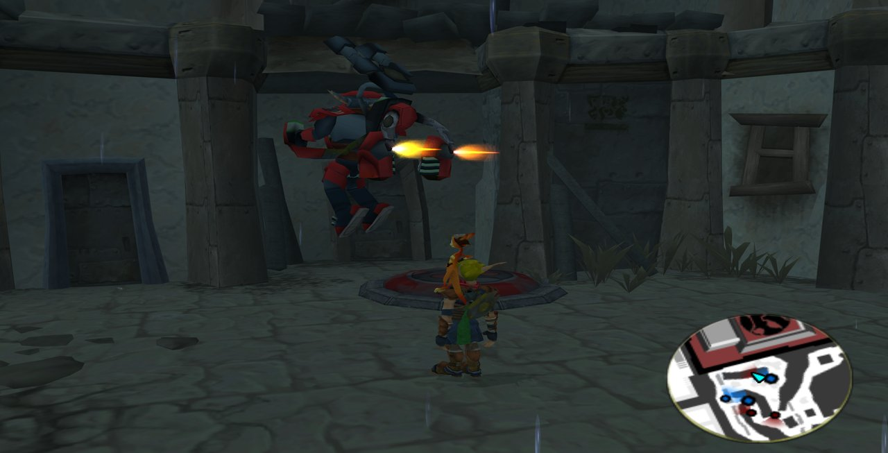

### 5.1 The switch

The menu's war entry is greyed out and can't be chosen while the mod is off. The shared menu file
draws a disabled flag like an enabled one, and the project rules forbid editing it, so the mod's
menu uses a flag type of its own that draws greyed out when disabled (`hj2-menu-flag`,
`jak2-haven-city-menu.gc`; the code is in the wiki,
[4.36](../../../.agents/skills/goal-lisp/wiki/jak3.md#436-the-mods-menu-a-greyed-out-flag)).

Switching the war rebuilds the traffic of the city loaded now, because a guard's look is chosen
when its process is made.

### 5.2 Looks and sides

During the war, each new guard takes the look that is furthest below its share in proportion: 10
blue, 4 red rifles, 3 red grenade launchers, 2 yellow rifles, 1 yellow launcher, out of 20. In
proportion, so that the first guards made alternate the sides: counted in guards missing, the
blue look came first six times, and the traffic wakes a pool's first guards first. A red or yellow
guard is drawn with Jak 2's model but plays the blue guard's clips, so it walks, shoots and dies
exactly like one.

Who fights whom comes from Jak 3's **attack controller**, a table of hatreds between kinds of
units. The Krimzon Guards (and the red jetpack guards) are the faction praxis-kguard: they register
with a type of their own, 13 (`HJ2_TARGET_PRAXIS`). Jak 3 makes the controller for 17 types and uses
0 to 12, so 13 is free, and Jak 3's table has nothing for it: the KG robots and the Metal Heads
leave the faction alone, as it leaves them. The director adds its entries (`hj2-war-hatred-set!`,
`hj2-war-city.gc`):

| Who | Seeks | Hatred | Distance |
|---|---|---|---|
| Blue guards | Krimzon Guards | 0.9 | up to 160 m (full up to 100 m) |
| Krimzon Guards | Blue guards | 0.9 | up to 160 m |
| Krimzon Guards | Citizens | 0.7 | up to 100 m |
| Krimzon Guards | Jak | 0.6 | up to 100 m (as Jak 3's KG robots) |

Counted in a test, 3 minutes of war: 7 to 10 Krimzon Guards aiming at blue guards and as many blue
guards aiming at them, every 10 s. Until then the Krimzon Guards registered as KG robots (9), which
made them one faction with Jak 3's robots.

A unit picks the target with the best score, its hatred times a distance factor. With 0.4 the
Krimzon Guards never chose a citizen over a guard; 0.7 has 4 to 7 of them chasing citizens at once.
The stock table comes back when the war stops, unless a Jak 3 mission set its own.

### 5.3 Weapons

Blue guards fight with the rifle and the grenade launcher only ([3](#3-changing-jak-3-without-breaking-it-hooks)).
The hook alone was not enough: the traffic keeps guards in a pool and reuses them, and a pooled
guard keeps the weapon it had before the war. The director re-arms the tazer-armed ones every
0.5 s (`hj2-war-rearm-guards`). Test: 9 blue guards of 12 still had the tazer before, none after.

A lesson on hooks, from the war's worst bug. When a hook changes what a stock function decides,
read the callers of that function too. Off screen, every 16 frames, Jak 3 offers each guard
another weapon (`crimson-guard-method-270`): it calls the weapon method, then answers "changed",
and its callers send the guard to its hostile state again. With the hook, a Krimzon Guard keeps
its rifle, so nothing changed, yet the answer was still "changed": every Krimzon Guard out of view
restarted its attack state 4 times a second, and the city crashed within a minute or two, in
places that had nothing to do with it (the kernel, the minimap, the transport). A bisection found
it: Krimzon Guards with the squad's weapons ran 4 times without a crash, with rifles only they
crashed 3 times in 4. The fix is one marked line: the off-screen change compares the weapon the
guard would really get. Since then, 16 test runs of war, none crashed.

The same hook hid a second bug. A transport wakes its guards with the weapon code 11, "keep the
one you have", and a pooled blue guard then kept the squad's guard type for a vehicle's gunner,
which no guard on foot has. Landing from the jump, it looked for its attack state by weapon, found
none, and its code ran to its end, which kills a process: the blue guards vanished as they touched
the ground. The hook now gives a blue guard of the war the rifle or the launcher for anything but
those two.

### 5.4 The rifle butt

Jak 3's guards strike with the rifle butt when their target is close. During the war two guards
of opposite sides meet often, and they spent the fight hitting each other. Now a guard strikes
only when its target is Jak (`hj2-war-melee-ok?`); against another guard it keeps shooting. Three
paths lead to the strike (the rifle's, the grenade launcher's, and the general check of a close
target in `guard-states.gc`); with the first two only, a guard still struck another one in about
one count in three. With the three: none in 24 counts of 60 s of war.

### 5.5 Spawn distance and density

Jak 3's traffic makes units appear in the street cells near the camera: within 20 m off screen for
guards and citizens, 120 m for vehicles. During the war the mod widens these to 80 m and 180 m
(`hj2-war-cell-dist`), so guards come from further away and the fights look larger. The number of
guards stays 20: with 30, the city's navigation meshes ran out of room for them (`unable to
allocate nav-mesh` in the log) and the game crashed.

### 5.6 Death: the purple cloud

A blue guard that dies dissolves in a purple cloud: its death clip carries Jak 3's `death-default`
effect. The red and yellow guards fell and stayed. Three causes, found one after the other:

1. **No effect control.** A `build-actor` model has none, so its clips' effects never ran. The mod
   makes one when the guard is created (`hj2-war-guard-clips`).
2. **A crash.** `death-default` then switched the model to the game's generic renderer, which
   can't draw a custom model: the game crashed. The mod cancels that switch and draws the cloud
   itself, sparks rising from the guard's joints for 15 frames (`hj2-war-death-fx`).
3. **Invisible sparks.** The spark particle has no texture of its own; the game adds it only when
   launching through `merc-death-spawn`. Launched any other way, nothing showed.

The code and the evidence are in the wiki,
[4.35](../../../.agents/skills/goal-lisp/wiki/jak3.md#435-build-actor-models-their-effects-the-death-cloud-another-mesh-at-runtime).

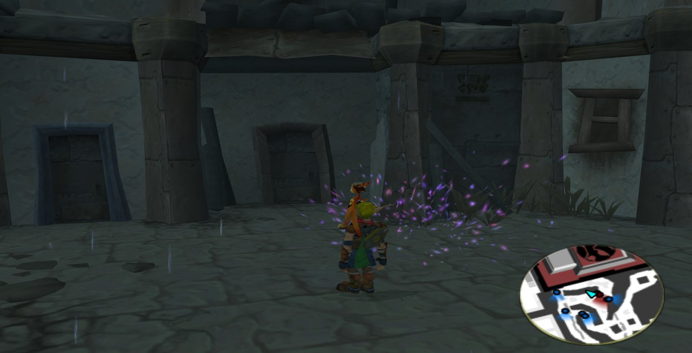

The Krimzon Guards of the places around the city (`hj2-kg-soldier`, a `nav-enemy`) had a fourth
cause: a guard's death clip doesn't run `death-default` itself, it sends the guard `'event-death`,
and the guard's own event handler runs the effect. A `nav-enemy` ignores that event. The soldier
now handles it like Jak 3's guard does (`jak2-haven-city-kg.gc`).

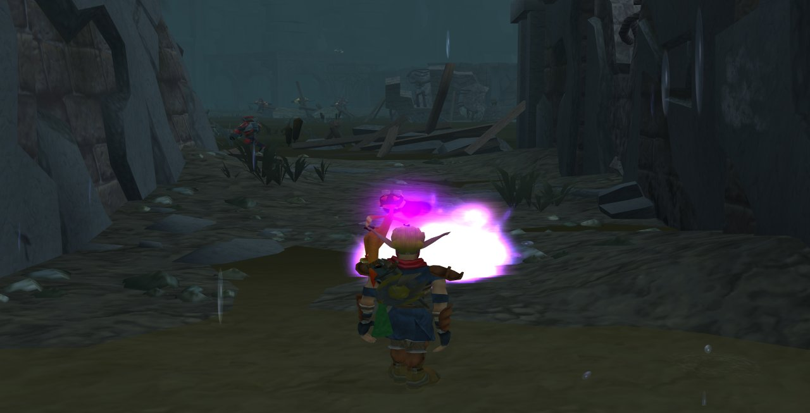

Checked side by side: a Krimzon Guard (top) and a blue guard (bottom) killed in front of Jak, shot
2, 8, 16 and 30 frames after their cloud starts. Both play the same death clip at the same pace,
and the cloud starts at the same clip frame (frame 81 and 84 after the kill in one test).

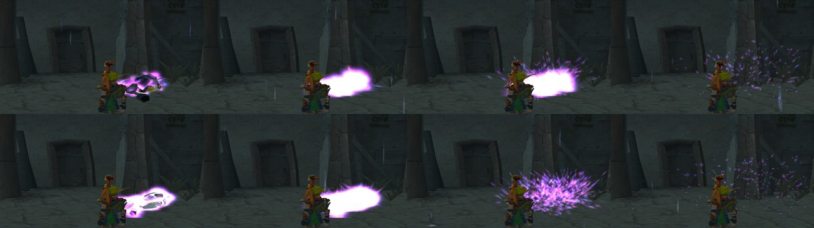

### 5.7 Voice lines

Jak 2 waits, after a guard's line ends, for the next line's delay before starting it; Jak 3 counts
the delay from the last line of the same kind, so lines came one after the other, and its two
speech channels could talk at once. In Jak 2's city the mod applies Jak 2's rule and lets no line
start while the other channel speaks (`hj2-speech-ready?`). During the war the Krimzon Guards say
Jak 2's lines, the blue guards Jak 3's; a guard saying Jak 2's lines in a fight uses those Jak 2
had for a driving or a Dark Jak target when Jak is one. Every war line is picked at random among
its set.

| Lines a war guard can say (per voice, read in game) | Before | Now |
|---|---|---|
| Krimzon Guard | Jak 2's 222, in a fixed order | Jak 2's 261 (39 more for a driving or Dark Jak target), at random |
| Blue guard | The same 222 as the Krimzon Guards | Jak 3's 66, with Jak 3's voices, at random |

Measured in game, 2 minutes of war in the slums, the lines as they were before (the type hook off,
no random order) against now:

| | Before (2 runs) | Now (3 runs) |
|---|---|---|
| Lines heard | 39 and 24 | 21, 19 and 16 |
| Different lines | 35 and 24 | 19, 16 and 16 |
| Blue guards' lines from Jak 3 | 0 of 11, 0 of 8 | 8 of 8, 2 of 2 (no blue guard near in the third) |

One trap on the way: the blue guards first used Jak 3's speech tables as they are, whose own
spacing holds a type's next line 15 to 23 s for every guard; with Jak 2's spacing on top, they spoke
0 to 2 lines in 2 minutes and silenced the channel. They now use copies of those tables
(`*hj2-war-blue-speeches*`, `havenj2-traffic.gc`), spaced like Jak 2's line of the same type; Jak 3's
own tables stay as they are for Jak 3's city.

### 5.8 Transports and vehicles

A troop transport lands near Jak every 45 to 90 s and drops guards of its side, the two sides in
turn: a red Krimzon Guard ship with red and yellow guards, a blue Freedom Fighters ship with blue
guards ([5.3](#53-weapons) for why the blue ones once vanished on landing).

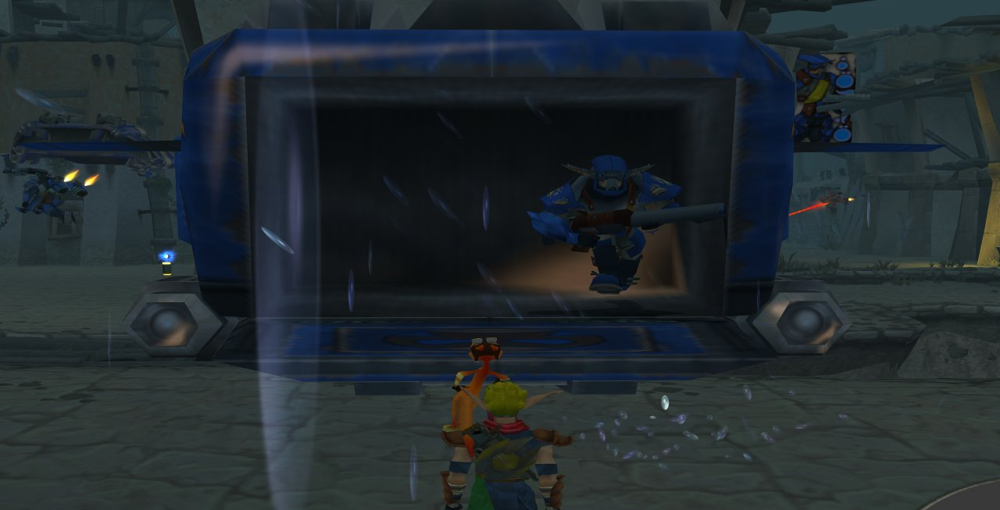

The Hellcats and guard bikes fly the lanes during the war too, half red, half blue, and they are
rare: one Hellcat and one guard bike at most (`HJ2_WAR_AIR_VEHICLES`, `hj2-guard-vehicle-caps`).
Each is flown by a guard of its side: a red or yellow Krimzon Guard in a red one
(`hj2-hellcat-pilot setup-lods`). Each goes after the other side (`hj2-war-vehicle-foe`, every
frame while it has no target): a red one after the nearest blue guard on foot or Jak within 100 m,
a blue one after the nearest red or yellow guard, never Jak (`hj2-war-vehicle-may-hunt-jak?`
keeps it out of the alert's chase and of Jak's hits too). Seen in a test: a blue Hellcat with its
blue pilot chasing a Krimzon Guard, a red bike with a red pilot chasing a blue guard. Three runs
of 3 minutes of war, every vehicle's pilot checked against its color as it came out: 18 pilots, 0
of the wrong side. The transports' guards in the last two: 39 landed and fought (rifle, grenade
launcher, or knocked back on landing), 0 vanished.

### 5.9 Praxis KG invasion

The second war mode (Mods menu, "Praxis KG invasion"), in Jak 3's city once its story is over (its
last boss beaten, `hj2-story-done?`). The faction praxis-kguard (the same red and yellow guards as
the war's, and red jetpack guards; a target type of its own in Jak 3's attack controller,
[5.2](#52-looks-and-sides)) fights the Freedom League in the conflict zones picked in the
menu, several at once, the port by default. In a zone the two sides are all there is: no KG robot,
spydroid, Metal Head or Wastelander comes out there, even where Jak 3 had its own fight. Outside
the zones the city is Jak 3's own, and no ship flies, of either side: no transport, no guard
vehicle.

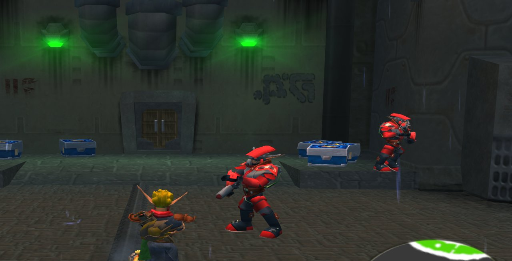

A zone is a group of Jak 3's territories (`nav-territory-type`, each street of its navigation
graph has one), the groups Jak 3's faction manager uses itself:

| Menu entry | Jak 3's territories |
|---|---|
| Port | `port-ff-deep` to `port-ff-kg-border`, `port-ff-near-mh`, `port-ff-mh-border` |
| Industrial Section | `inda-*`, `indb-*` (the KG robots' land) |
| Slums | `sluma-*`, `slumb-ff-deep`, `slumc-ff-deep`, `genc-border`, `genc` |
| Metal Head land | `mhcity-*` |

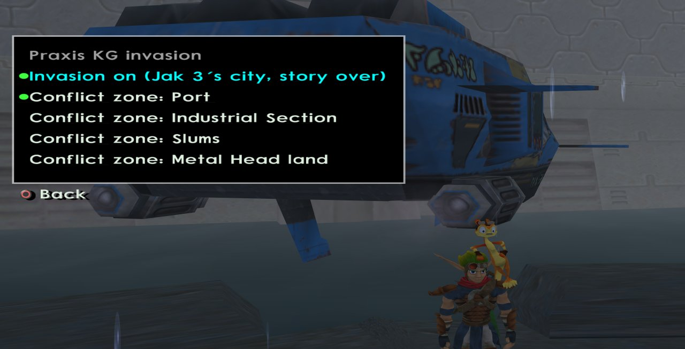

Three hooks hold the zones, each giving Jak 3's own answer outside them:

| Hook | Called by | In a conflict zone |
|---|---|---|
| `hj2-invasion-permission` | `cty-faction-manager-method-14`, the spawn permission of a faction in a territory | The Freedom League's guards and the KG's slot are allowed (their borrow levels load: CTYPESA with both sides' guards, CTYPESC with the jetpack guards), the KG's pedestrians and the Metal Heads are not |
| `hj2-invasion-spawn-ok?` | `activate-by-type`, before a unit goes out on a street | Only the two sides' guards, the jetpack guards and the citizens |
| `hj2-war-wake-ok?` | `hj2-get-from-inactive` (added to `traffic-engine.gc`), the pick of a sleeping unit | A guard of either side, the side with fewer guards out first; outside a zone a Freedom League guard only. A jetpack guard in a zone, a stock flying turret elsewhere |

The guards' pool holds both sides (half Freedom League, half Krimzon Guard, 20 guards; the flying
turrets' half jetpack guards), so the third hook is what keeps the Krimzon Guards in the zones.
The street a unit goes out on is only known in `activate-by-type`: it hands its territory to the
pick through a global, because other wakes (a parking spot, a transport, a mission) give no street
and left garbage where the pick read one.

Test, with a save whose story isn't over (the test's own copy of `hj2-story-done?` answered yes; no
task was closed, no save written): in the port, the guards woke alternately red and blue, fought,
and only blue guards came out in the slums. That city state has few guards, so the zone looked
thinner than a finished story's city will.

## 6. Color variants

### 6.1 The models and their textures

The objects asked for, with the Jak 2 model each is rebuilt from (under
`decompiler_out/jak2/levels/`) and the models the level port writes (under
`custom_assets/jak3/models/custom_levels/`):

| Object | Jak 2 model (rip) | Generated models | Textures |
|---|---|---|---|
| Krimzon Guard (unit) | `forresca/crimson-guard-lod0.glb` | `hj2-kg-red`, `hj2-kg-red-gl`, `hj2-kg-yellow`, `hj2-kg-yellow-gl` | 46, among them the red armor `cguardgame-metalered-01`, `-shouldershield`, `-armshield`, `-scarf` and the yellow armor `darkguard-headshield`, `-scarf`, `-shouldershield`, `-armshield` |
| Krimzon Guard (jetpack) | `forresca/crimson-guard-hover-lod0.glb` | `hj2-hover-red`, `hj2-hover-blue` | 19, red: `cguardgame-metalered-01`, `cguardgame-shouldershield` |
| KG transport | `forestb/transport-lod0.glb` | `hj2-transport`, `hj2-transport-blue` | `kgtrns-side01`, `kgtrns-side01-envmap-strength`, `kgtrns-wing01`, `kgtrns-box01`, `kgtrns-topjet01`, `kgtrns-hatch01`, `war-armor-weathered` |
| City anti-air turret | `ctywide/cty-guard-turret-lod0.glb`, `ctywide/cty-guard-turret-explode-lod0.glb` | `hj2-cty-guard-turret`, `hj2-cty-guard-turret-explode`, `hj2-cty-guard-turret-blue`, `hj2-cty-guard-turret-explode-blue` | `kgt-ribs01`, `kgt-rim01`, `kgt-logo01`, `kgt-gun01` to `kgt-gun05` |
| Hellcat | `lwidea/hellcat-lod0.glb` | `hj2-hellcat-red`, `hj2-hellcat-blue` (out of the war: Jak 3's own `hellcat-ag`) | 23: `wing01`, `wing02`, `wing02grey01`, `jetTop01`, `jets01`, `backThing01`, `stripe03`, `hood01`, `grillRim01`, `post01`, `turret01`, `lightCase01`, `rail01`, `kcfrontend01`, `light01`, `dash01`, `gunBoxBack01`, `gunbox01`, `gunbox02`, `gunBoxFront01`, `seat01`, `gauge01`, `windshield01` |
| Krimzon Bike | `lwideb/crimson-bike-lod0.glb` | `hj2-guard-bike` (blue), `hj2-guard-bike-red` | `kcbackjet01`, `kccorg01`, `kcfrontend01`, `kcfrontgard01`, `kccushion01`, `bike-02` |

Where the game uses each color:

| Object | Out of the war | During the war |
|---|---|---|
| Anti-air turret | Blue | Blue (the city's turrets are the Freedom League's) |
| Transport | (none) | Red for the Krimzon Guard's ships, blue for the Freedom Fighters' |
| Hellcat | Jak 3's own | Half red, half blue (by process id), one at most, a pilot of its side |
| Guard bike | Blue | Half red, half blue, one at most, a rider of its side |
| Jetpack guard | (none) | Red or blue, by side |

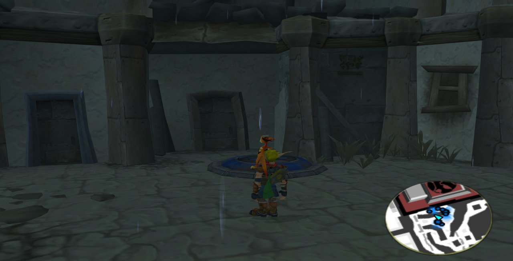

| | |
|---|---|
| 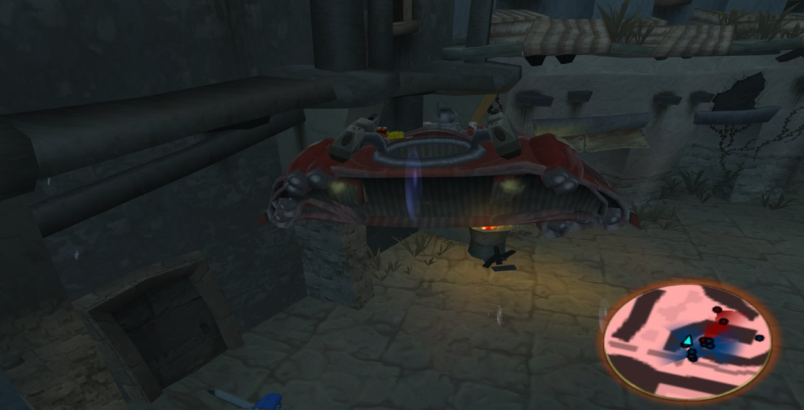 | 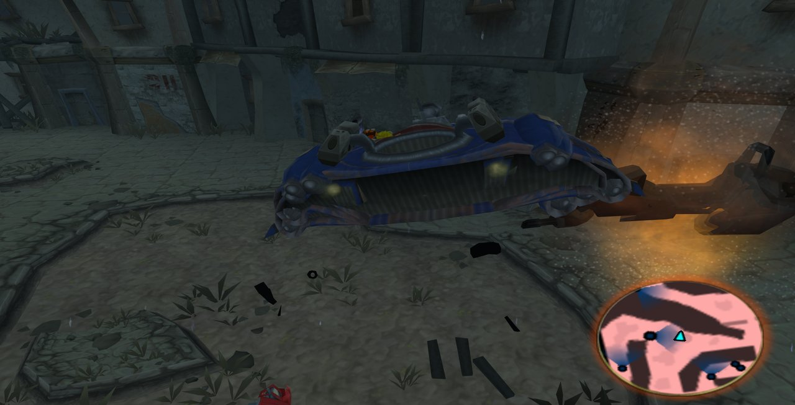 |
| 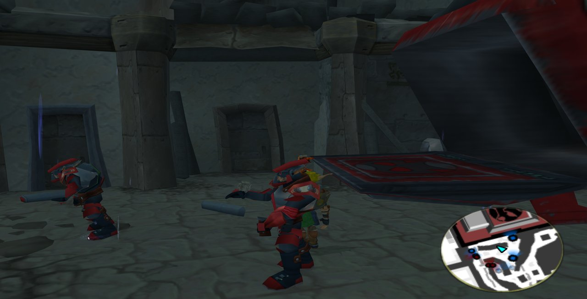 | 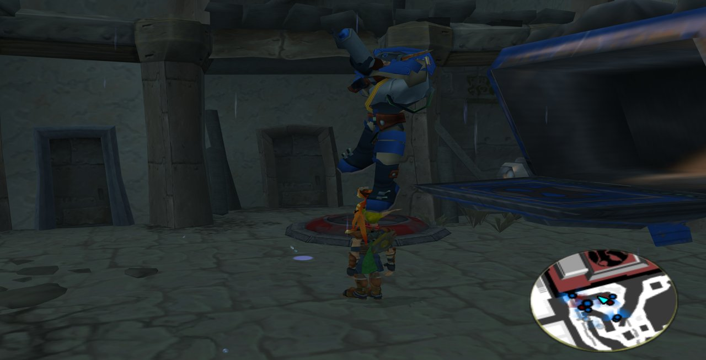 |

### 6.2 How a variant is made: `recolor`

A variant is one more model entry in the manifest, made from the same rip with a `recolor` rule.
A rule turns the hue of some texels: those whose hue is in a window, in degrees on the color
wheel (red is 0, blue about 217), and whose saturation is high enough (greys are left alone).
It changes no geometry and stores no texture in the repository: the recolored textures are made
on each machine from the player's own Jak 2.

The blue transport:

```json
"hj2-transport-blue": {"model": "hj2-transport-blue", "rip": "forestb/transport-lod0.glb",
                       "prims": null, "collide": null, "anims": ["idle", "hatch-open", "hatch-close"],
                       "recolor": {"hues": [-15, 15], "rotate": 217, "min_saturation": 0.3}}
```

The texels within 15 degrees of red, at 30 % saturation or more, turn by 217 degrees: blue. A
rule can be limited to some textures (`"textures": [...]`), and `recolor` can be a list of rules
applied in order.

Why the bike and Hellcat rules name their textures and go one way only: the mod's texture pack
paints some of those textures blue, and the rips are extracted with the pack when it is installed.
A red-to-blue rule leaves an already blue texel as it is, a blue-to-red rule turns it red, so
each variant comes out the same with or without the pack. Limiting the rule to the textures the
pack paints keeps the Hellcat's windshield, naturally bluish, as it is.

### 6.3 Making a new variant

1. **Find the hues.** List the textures of the rip and their main hues, from the repository root
   (a reading aid, nothing to commit):

   ```bash
   python -c "
   import base64, colorsys, json, struct, sys
   sys.path.insert(0, 'scripts')
   from level_port.common.glb import png_decode
   data = open(sys.argv[1], 'rb').read()
   gltf = json.loads(data[20:20 + struct.unpack_from('<I', data, 12)[0]])
   for im in gltf['images']:
       w, h, px = png_decode(base64.b64decode(im['uri'].split(',', 1)[1]))
       bins = {}
       for i in range(0, len(px), 4):
           hue, sat, val = colorsys.rgb_to_hsv(*(c / 255 for c in px[i:i + 3]))
           if sat >= 0.3:
               b = round(hue * 12) % 12 * 30
               bins[b] = bins.get(b, 0) + 1
       top = sorted(bins.items(), key=lambda kv: -kv[1])[:3]
       print(im['name'], f'{w}x{h}', ', '.join(f'{b} deg: {100 * n // (w * h)} %' for b, n in top))
   " decompiler_out/jak2/levels/forestb/transport-lod0.glb
   ```

   Each line names a texture and its most common saturated hues, in steps of 30 degrees (0: red,
   30: orange-brown, 60: yellow, 210: blue).

2. **Add the model** to the manifest's `models`: copy the original entry, give it a new `model`
   name and a `recolor` rule (or a list of rules).
3. **Load it** where the game needs it: add the name to the `models` list of the level that uses
   it (`havenj2` for the city; the war's `hj2-war` too for Jak 3's city, and its art group in
   `goal_src/jak3/dgos/ctypesa.gd` with a line in `game.gp`, as `hj2-transport-blue`), or to the
   original's `extras` to put it in the same levels.
4. **Declare it in GOAL** with `def-actor`, the same bounds and origin joint as the original, and
   choose it in the class's code: at init (the transport takes its side's,
   `hj2-transport-init-by-other`), or at runtime (the turret,
   [wiki 4.35](../../../.agents/skills/goal-lisp/wiki/jak3.md#435-build-actor-models-their-effects-the-death-cloud-another-mesh-at-runtime)).
5. **Build:** run the level port, then `(mi)` ([8](#8-building-and-testing)).

A rule only turns hues: a darker or lighter version needs a new key in `recolor_pixels`
(`scripts/level_port/common/glb.py`), or a retouched texture (6.4).

### 6.4 The variants' textures in a texture pack

Each run of the level port writes every recolored texture as a PNG, in a texture pack's layout:
`docs/modding/current_mod/texture_packs/variants/custom_assets/jak3/texture_replacements/_all/`
(31 files; made from the player's games, so kept out of git). Each takes its variant's name,
`<texture>-<model>`: `kgtrns-side01-hj2-transport-blue.png`, `kcfrontgard01-hj2-guard-bike-red.png`...

Why new names: a texture pack replaces textures by name, everywhere. A blue `kgtrns-side01.png`
in a pack would paint the red transport too, and the level port takes Jak 2's models with the
installed pack applied. Under its own name, a variant's texture changes that variant only.

The existing pack (v1.0.0) already paints some of these textures blue under their original names
(`hood01`, `wing01`, `kc*`, `kgt-gun05`...). That is why the red variants turn those textures back
to red (their `recolor` rule lists them; the red turret since this change: its `kgt-gun05` came out
blue with the pack installed), and why the blue ones come out the same with or without it.

The pack v1.1.0 (`docs/modding/current_mod/texture_packs/haven-city-new-dawn-textures-v1.1.0.zip`)
holds the 25 files of v1.0.0 and the 31 variant textures. The next release ships it: the release
workflow uploads every zip of that folder and registers it in `index.json` by itself
(`scripts/modding/update_mod_catalog.py`), so nothing else is needed.

To retouch a variant and ship it in a new pack:

1. Edit its PNG in the variants folder (an image editor; keep the file name).
2. Make the new pack: the latest pack's files (never overwritten: a variant whose name a pack file
   already has is left out and reported), plus the variants' files, version raised (1.2.0 after
   1.1.0):

   ```bash
   python custom_assets/jak3/ports/jak2-haven-city/make_texture_pack.py
   git add -f docs/modding/current_mod/texture_packs/haven-city-new-dawn-textures-v1.2.0.zip
   ```

   The folder ignores zips (`.gitignore`), so the pack you ship needs `git add -f`.
3. With the pack's PNG in `custom_assets/jak3/texture_replacements/_all/`, the level port uses it
   for that variant instead of recoloring (`texture_dir` of `rebuild_model`).

A release does not make the pack: its runners have no Jak 2 to make the variants from. Make it on
your machine and commit it before the release. Without retouches no pack is needed: every install
recolors the variants itself.

Checked: a pack file `kgtrns-wing01-hj2-transport-blue.png` replaced that texture in the rebuilt
model and the export, the transport's 6 other textures were recolored; in game, the red turret, the
blue transport, Hellcat and guard bike drew with their renamed textures.

## 7. What the repository holds, and what it doesn't

The repository never holds what is made from the games' files. Each player's install makes it
from their own Jak 2 and Jak 3:

| In the repository | Made on each machine |
|---|---|
| The mod's GOAL code, the level port, the manifest | Every level file of `custom_assets/jak3/levels/hj2-*/` and `havenj2/` |
| Torn's voice lines for the speakers, the user's own recordings, and their encoder: `custom_assets/jak3/ports/jak2-haven-city/voices/` | Every model `.glb` of `custom_assets/jak3/models/custom_levels/hj2-*` (the variants included) |
| These screenshots (`docs/modding/current_mod/images/`) | The particles, sounds, music and voice lines taken from Jak 2 |
| The script that makes a texture pack of the variants (`make_texture_pack.py`, [6.4](#64-the-variants-textures-in-a-texture-pack)) | The variants' textures (`texture_packs/variants/`) |
| The mod's texture pack as a zip (`texture_packs/`) | The extracted games (`iso_data/`, `decompiler_out/`, `out/`) |

How it stays that way: a full run of the level port writes the list of every file it generated
into a block of `.gitignore` (the manifest's `ignore_outputs`), so a new model is ignored as soon
as the port has made it once. At install, the launcher runs the mod's extractor, which runs the
level port on the player's discs; Jak 2 and Jak 3 must both be installed in the launcher first.
The texture pack is optional: the color variants come out the same without it.

Two things the repository still holds, now that it is public:

- **Old commits still hold `.glb` files**: 124 files, 172 versions, 61 MB (16 MB packed), level
  meshes and models added before they were generated at install. Removing them rewrites the
  history; it is not done, by the owner's choice (2026-11-04). The procedure below was tested on a
  throwaway copy: 70 commits rewritten in about a minute, no `.glb` of the mod left, the upstream
  test models (`test-actor.glb`, `test-zone2.glb`) kept, the last commit's files unchanged, and
  `master-dev`'s commits untouched (only the mod's own commits are rewritten, so later syncs from
  `master-dev` stay clean).
- **The texture pack zips** (`docs/modding/current_mod/texture_packs/`, v1.0.0 and v1.1.0) hold
  textures of the games, repainted. They are committed so that the release workflow finds them.

The history rewrite, when the owner decides it: in a bare clone of the mod's repository
(`git clone --bare`), where `main` and the two release tags are the refs to rewrite. `dd14a7829`
is the first commit that added one of these files; `bac2f2e07` is the last `master-dev` commit
merged into the mod (take the current one: `git merge-base main master-dev`). Excluding what
`master-dev` holds matters: `filter-branch` drops commit signatures, so rewriting `master-dev`'s
merged commits would change their hashes even without a file removed. Name the refs: `--all`
would also rewrite every other branch and remote of a clone that holds several mods.

```bash
git filter-branch --tag-name-filter cat --index-filter   'git rm -r -q --cached --ignore-unmatch -- "custom_assets/jak3/models/custom_levels/hj2-*.glb" "custom_assets/jak3/levels/*/hj2-*-mesh.glb" "custom_assets/jak3/levels/havenj2/havenj2-mesh.glb"'   -- main haven-city-new-dawn-v1.0.0 haven-city-new-dawn-v1.0.1 --not bac2f2e07 dd14a7829^
git push --force origin main haven-city-new-dawn-v1.0.0 haven-city-new-dawn-v1.0.1
```

Tested exactly so on a copy (2026-11-04): `main` and both tags rewritten, none of them holding a
`.glb` of the mod any more, their files otherwise identical.

After it: the two release tags (`haven-city-new-dawn-v1.0.0`, `-v1.0.1`) point to the rewritten
commits (`--tag-name-filter cat`), every clone and worktree of the mod must be made again, and
GitHub may keep the old objects until its own cleanup (its support can run one on request).

## 8. Building and testing

```bash
task set-game-jak3
task build-release-game       # the level builder and the runtime changed
task build-release-decomp     # the decompiler changed
task level-port -- custom_assets/jak3/ports/jak2-haven-city/port.jsonc
task compile-check            # headless (mi)
task boot-game                # debug boot; task boot-game-retail for the launcher's
```

After switching to this mod from another one in the same clone, force the first build with
`(make-group "iso" :force #t)`: the shared `out/` folders can hold the other mod's files.

**How the war mode and the color variants were tested.** A temporary GAME file (never committed) starts a process at
boot that switches the mod and the war on, warps Jak, moves models in front of the camera, counts
units and their targets, and takes screenshots (`pc-screen-shot`), printing `HJ2TEST` lines to the
log. A small Python script starts `gk` in debug mode (`-boot -fakeiso -debug`), reads the log and
stops the game at the end of the scenario or on a crash. The scenario process runs on the real
clock (`*display*`'s `real-clock`) so that it goes on while a menu pauses the game.

Each test run starts a fresh `gk` after the build, so it is a cold boot. The final run
was a retail boot (`task boot-game-retail`'s arguments, no debug segment): the mod and the war
switched on through the Mods menu's own entries, the warp taken through the "Warp to Haven City
(Jak 2)" submenu, then a minute of war. Praxis KG invasion needs Jak 3's story over: its scenario
answers `hj2-story-done?` itself, in the temporary file only, so no task is closed and no save is
written. To see a vehicle up close,
the scenario puts Jak at its controls (`'change-mode 'pilot` with that vehicle): the camera follows
it.

A cold boot is the final check: code reloaded into a running game can look right while a fresh
start fails. Saves and settings stay from one boot to the next
(`%APPDATA%/OpenGOAL/jak3/saves/` and `settings/pc-settings.gc`).

## 9. Known issues

- **Not played by a player yet:** the war modes, the color variants and the alert's end were
  tested in boots driven by test scenarios, the last one a retail boot ([8](#8-building-and-testing)).
- **The turret and Dark Jak or Light Jak:** a city turret popping up as Jak turns into Dark Jak or
  Light Jak was not seen in tests (it stayed down for both, war on or off); its check now leaves
  them out by name.
- **Praxis KG invasion with a finished story:** tested with a save whose story isn't over
  ([5.9](#59-praxis-kg-invasion)). Its zones were tested in the port only: the industrial
  section's case (a zone where Jak 3 already had its KG robots fight the Freedom League) is written
  but not run in game.
- **A crash in the collision code, once:** in one of three runs of 3 minutes of war with two blue
  transports sent on top of the war's own, the game stopped in native collision code (a
  `collide-cache-prim` query reading a bad pointer) after 77 s; the two other runs went through.
  Earlier, 16 runs of the war without the war ships hunting guards went through. The cause isn't
  found.
- **The repository's history** still holds `.glb` files, and the repository is public: [7](#7-what-the-repository-holds-and-what-it-doesnt).
- More open points: [reference, 18](haven_city_new_dawn_reference.md#18-not-done-yet).
